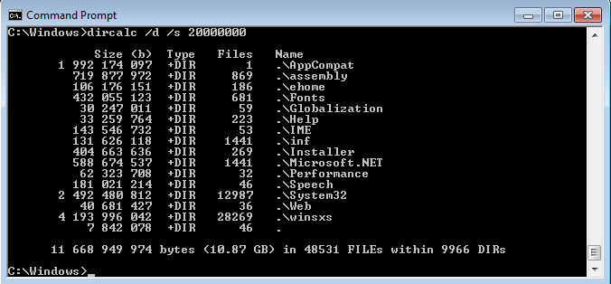

## dircalc

dircalc is a tiny but powerful and fast program that displays the disk usage in bytes for any given directory. Works on Windows / Linux / macOS, BSD.

### Usage: dircalc [/D] [/S size] [/L levels] [/A] [/O] [/T n] [/J threads] [directory_location]

 /D         Displays only the sizes of the DIRs, omitting the FILEs.
 
 /S size  Displays only FILEs and DIRs whose byte-size is = or > than given
          (size accepts K, M, G, T, P suffixes (1K = 1024), e.g. 500M, 2G).
               
 /L level Displays the FILE and DIR sizes for the given level (default 1).
 
 /A          Displays all files at all levels.
 
 /O          Sorts the listed entries by size, largest first.
 
 /T n       Displays only the n largest entries (implies /O).
 
 /J n        Number of scanning threads (default: automatic, 1 = serial).
 
 /H          Displays the help, i.e. this page.
 

Symbolic links, junctions and mount points are listed as LINK and not followed.

### Examples:

dircalc

dircalc C:\Users\Public\Desktop

dircalc /L 10 %temp%

dircalc /D \\REMOTE\Folder\

dircalc /S 1000000

dircalc /A

dircalc /D /L 3 /T 20 C:\Windows

dircalc /S 500M /A D:\Data
